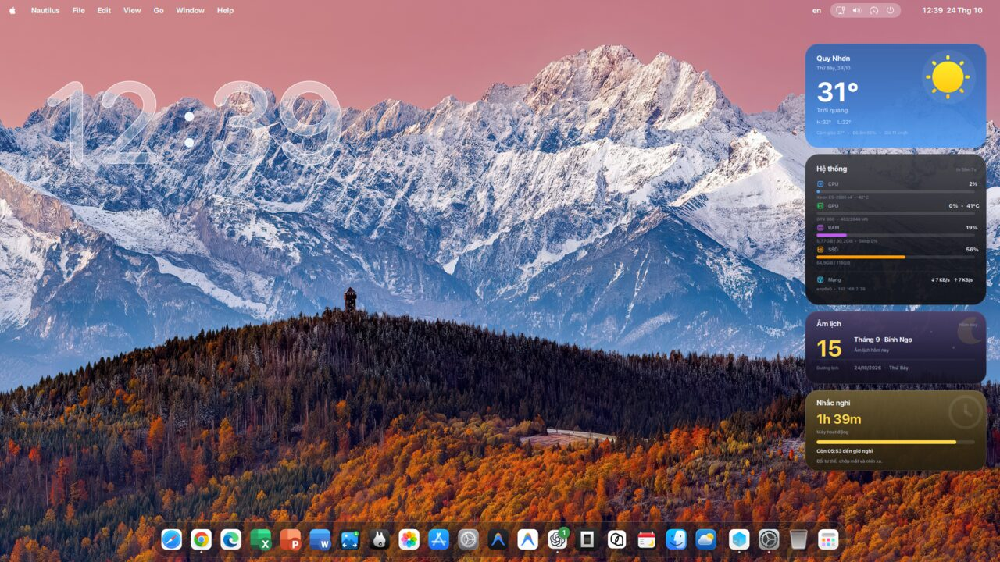
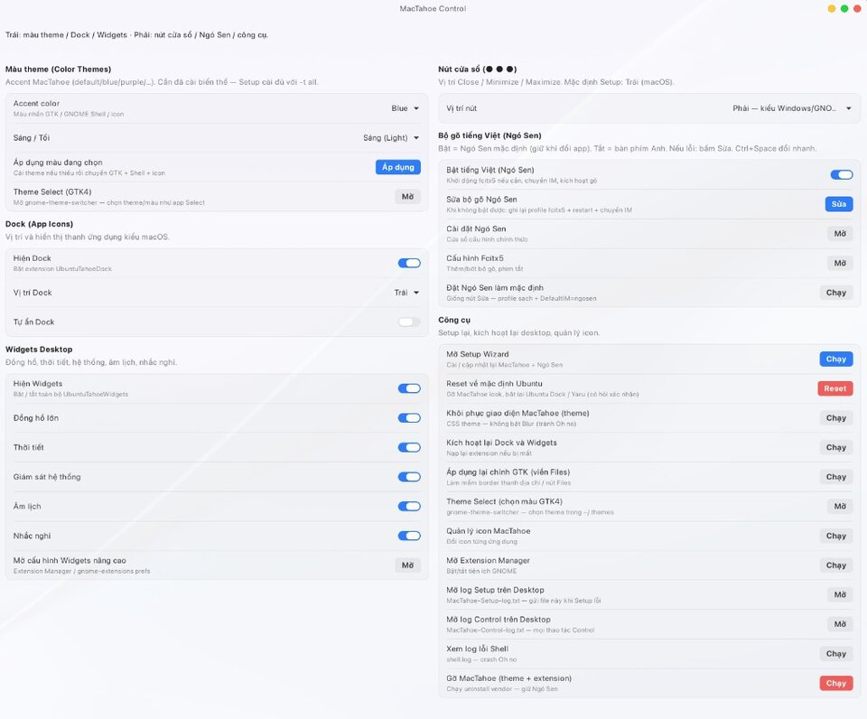
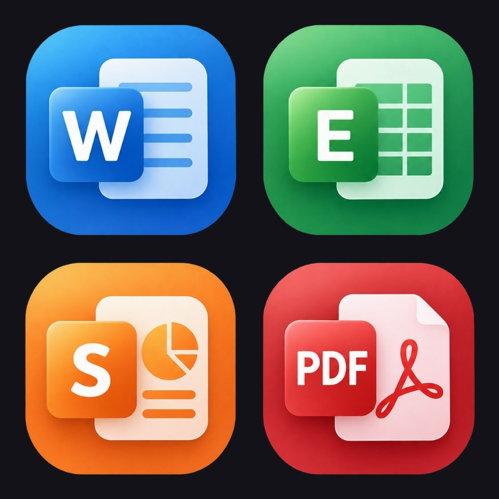
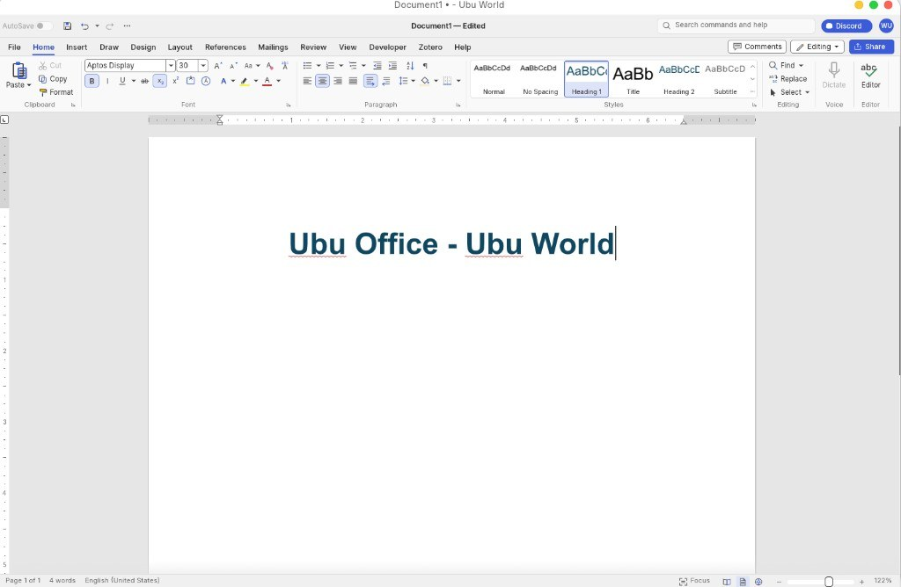
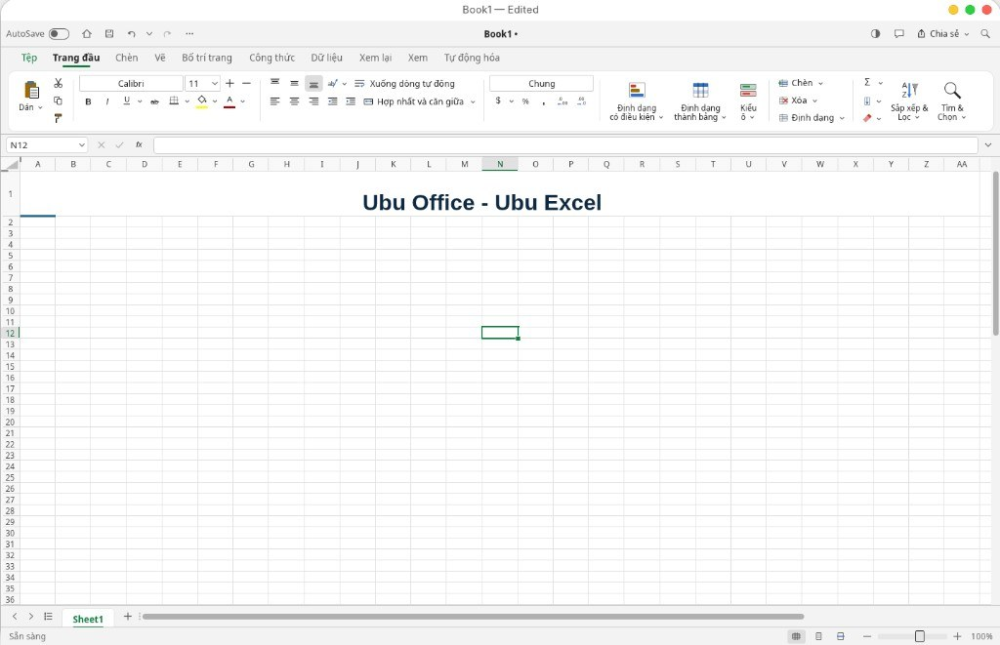
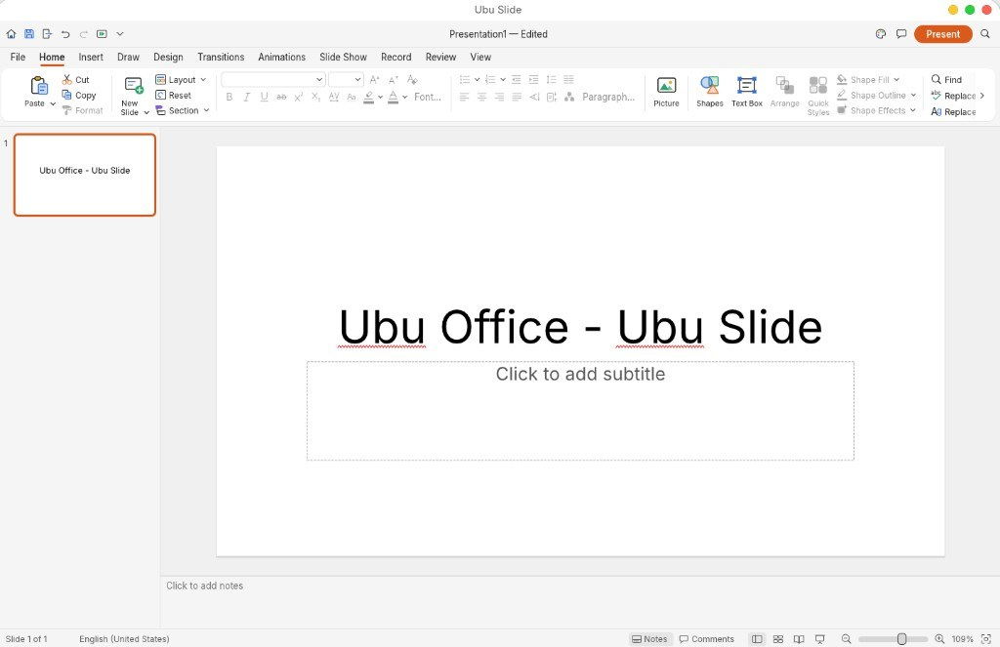
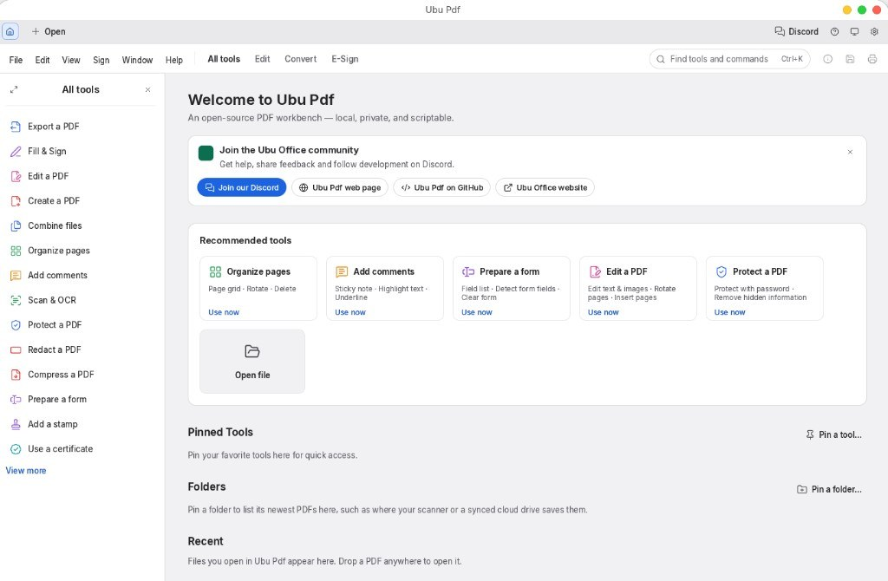

# Ubuntu macOS Theme Guide (English)

Install a **macOS-like theme on Ubuntu** with **MacTahoe**: GTK/Shell theme, Mac-style Dock, desktop Widgets, and optional **Ngó Sen** Vietnamese input — then manage everything in **MacTahoe Control**.

**Keywords:** Ubuntu macOS theme · make Ubuntu look like Mac · MacTahoe Ubuntu · GNOME Mac Dock · Ubuntu 20.04 22.04 24.04 26.04 theme · Linux macOS desktop

---

## Supported Ubuntu versions

| Version | Theme / icons | Dock + Widgets | Ngó Sen | Notes |
|---------|---------------|----------------|---------|--------|
| **26.04 LTS** | Yes | Yes (GNOME ~50) | Ngó Sen or Bamboo | Current LTS — full stack |
| **24.04 LTS / 25.x** | Yes | Yes (GNOME ≥45) | Ngó Sen or Bamboo | Recommended / interim |
| **22.04 LTS** | Yes | No | Ngó Sen or Bamboo | GNOME 42 |
| **20.04 LTS** | Yes (best-effort) | No | Bamboo (PPA) | CLI Setup if GTK4/Adw missing; no Ngó Sen offline |

Range in short: **Ubuntu 20.04 → 26.04**. Debian with GNOME is experimental; prefer Ubuntu.

---

## Install

### What you need

- Ubuntu **20.04 → 26.04**, GNOME session
- Prefer **Ubuntu on Xorg** when offered at login
- Your normal user with `sudo` — never run the AppImage as root
- **GDM (login screen) theme:** optional; higher risk — leave off unless you need it

### Steps

1. Download **`Ubuntu-macOS-Theme-Setup-x86_64.AppImage`** from the [latest Release](https://github.com/manguonmocom/ubuntu-macos-theme/releases/latest).
2. Make it executable: right-click → **Properties** → **Executable as program**.
3. **Double-click** the AppImage to open the **Setup Wizard** (on Ubuntu 20.04 without GTK4/Adw, Setup falls back to the terminal installer).
4. Leave **MacTahoe** checked. **Ubu Office** is checked by default. Choose IME (**None / Ngó Sen / Bamboo**). Leave **GDM** off unless you accept login-screen risk.
5. Enter your password when asked. If Ubu Office was checked, a separate **Ubu Office Setup** AppImage window opens (pick language + apps there).
6. Open **MacTahoe Control** from the Desktop or app menu when finished.

```bash
chmod +x Ubuntu-macOS-Theme-Setup-x86_64.AppImage
./Ubuntu-macOS-Theme-Setup-x86_64.AppImage
```

### After install

- One Mac-style Dock (Ubuntu 24.04+)
- MacTahoe window/icon look
- Optional Vietnamese typing (Ngó Sen `Ctrl+Space` or Bamboo `Super+Space`)
- Optional **[Ubu Office](https://github.com/manguonmocom/ubuntu-office)** apps in the application menu (`~/.local/bin/Ubu-*`)
- On **Wayland**, log out and log back in once if Dock/Widgets do not appear yet
- Setup always writes **`MacTahoe-Setup-log.txt`** on the Desktop

### Ubu Office in Setup

Office binaries are **not** bundled in the Theme Setup AppImage. When **Ubu Office** is checked, MacTahoe downloads **`Ubu-Office-Setup-*-x86_64.AppImage`** from [ubuntu-office releases](https://github.com/manguonmocom/ubuntu-office/releases/latest) and launches it as a **separate process** — language and World/Excel/Slide/Pdf are chosen in that wizard.

---

## Gallery





### Ubu Office



| World | Excel |
|-------|-------|
|  |  |

| Slide | Pdf |
|-------|-----|
|  |  |

## MacTahoe Control

```bash
mactahoe-control
```

Status messages appear at the top and bottom of the window.

### Quick

| Control | Meaning |
|---------|---------|
| **Preset Mac-like** | One click: Dock left, window buttons left, panel clock, wallpaper, current accent/mode |
| **Apply wallpaper** | MacTahoe Day / Night / Auto (follows Light·Dark) |

### Color Themes

| Control | Meaning |
|---------|---------|
| **Accent color** | Default (Tahoe), Blue, Purple, Pink, Red, Orange, Yellow, Green, Grey |
| **Light / Dark** | GTK + Shell mode |
| **Apply** | Install variant if needed, then switch theme, Shell, and icons |
| **Theme Select** | GTK4 theme picker (`gnome-theme-switcher`) |

### Dock

| Control | Meaning |
|---------|---------|
| **Show Dock** | Enable UbuntuTahoeDock |
| **Dock position** | Left (macOS-like), Bottom, Right, or Top |
| **Autohide Dock** | Show on screen-edge hover |

### Menu bar / Panel

| Control | Meaning |
|---------|---------|
| **Show date / weekday / seconds** | Top-bar clock options |
| **12h / 24h** | Clock format |
| **Apply macOS-style panel** | Date + weekday, 24h, no seconds |

### Desktop Widgets

| Control | Meaning |
|---------|---------|
| **Show Widgets** | Master switch |
| **Large clock / Weather / System / Lunar / Break** | Individual widgets |
| **Advanced Widgets settings** | Extension preferences |

### Window buttons

| Control | Meaning |
|---------|---------|
| **Button side** | Left (macOS ● ● ●) or Right (Windows/GNOME) |

### Vietnamese input (Ngó Sen or Bamboo)

Setup lets you choose **None / Ngó Sen (fcitx5) / Bamboo (IBus)**. Control shows tools for whichever is installed.

**Ngó Sen (fcitx5)** — Ubuntu 22.04+:

| Control | Meaning |
|---------|---------|
| **Enable Vietnamese (Ngó Sen)** | Prefer Ngó Sen; off = US keyboard |
| **Fix Ngó Sen** | Repair fcitx5 profile and switch IM |
| **Ngó Sen / Fcitx5 settings** | Official configuration windows |

**Ctrl+Space** toggles English ↔ Ngó Sen.

**Bamboo (IBus)** — Ubuntu 20.04→26.04 via PPA:

| Control | Meaning |
|---------|---------|
| **Enable Vietnamese (Bamboo)** | Switch IBus engine + GNOME input source |
| **Fix Bamboo** | `im-config` ibus, preload Bamboo, restart daemon |
| **IBus setup** | Engine preferences |

**Super+Space** switches GNOME input sources (US ↔ Bamboo).

### Font

| Control | Meaning |
|---------|---------|
| **Install Mac-like fonts** | SF Pro when downloadable; otherwise **Inter** from apt — then apply system fonts |

Use Ubuntu **Activities / Super** for app search (no third-party launcher).

### Tools

| Control | Meaning |
|---------|---------|
| **Write Control log to Desktop** | **Off by default.** Turn on only when you need `MacTahoe-Control-log.txt` for support. Setup logs stay on. |
| **Open Setup Wizard** | Reinstall / update components |
| **Re-activate Dock & Widgets** | Reload extensions |
| **Icon manager / Extension Manager** | Icons and GNOME extensions |
| **Re-apply GTK / Restore glass** | Restore Setup GTK and panel look |
| **Open Setup / Control log** | Desktop log files |
| **Reset to Ubuntu defaults** | Bring back Ubuntu Dock / Yaru |
| **Uninstall MacTahoe** | Remove theme/extensions (Ngó Sen packages kept) |

---

## Troubleshooting

| Problem | What to do |
|---------|------------|
| Dock / Widgets missing | Log out and back in (especially Wayland). Then enable them in Control. |
| Two docks | Keep MacTahoe Dock on; Ubuntu Dock should stay off. |
| “Oh no!” screen | On X11: `Alt+F2` → `r`. Avoid Log Out if you still need open apps. |
| Cannot type Vietnamese | Control → **Fix Ngó Sen**. |
| Need install details | Desktop: `MacTahoe-Setup-log.txt`. Optional Control log via Tools switch. |
| Older Ubuntu | 20.04/22.04: theme (and Ngó Sen on 22.04). Full Dock/Widgets on 24.04 → 26.04. |

**Activities:** Super (Windows) key.

---

## Vietnamese guide

Xem [HUONG-DAN.md](./HUONG-DAN.md).
