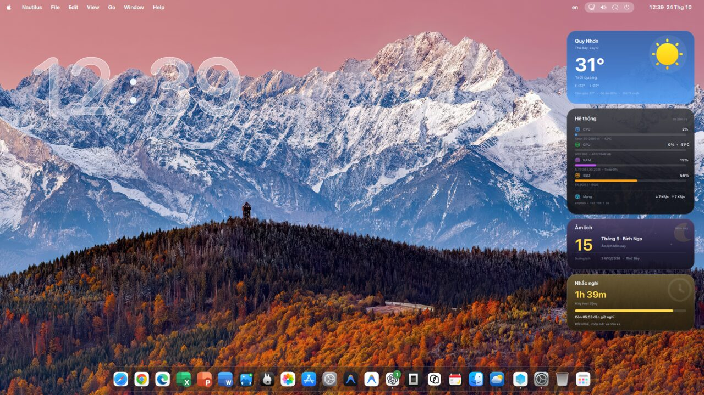
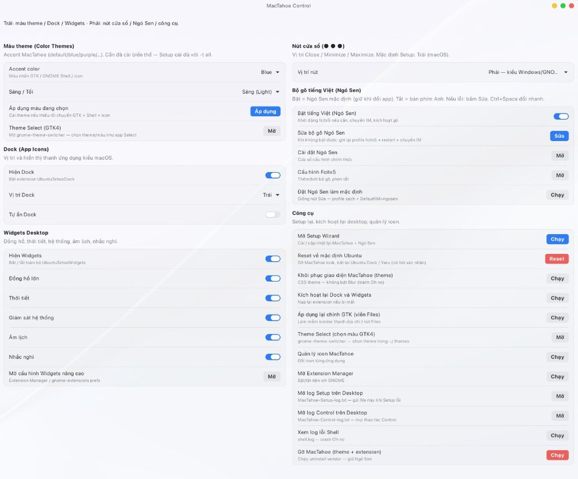

# Theme macOS cho Ubuntu — Hướng dẫn (Tiếng Việt)

Cài **giao diện giống macOS trên Ubuntu** với **MacTahoe**: theme, Dock kiểu Mac, Widgets desktop, và tuỳ chọn bộ gõ **Ngó Sen** — quản lý hàng ngày bằng **MacTahoe Control**.

**Từ khóa:** theme macOS Ubuntu · làm Ubuntu giống Mac · MacTahoe · Dock GNOME · Ubuntu 20.04 22.04 24.04 26.04 · giao diện macOS Linux

---

## Phiên bản Ubuntu được hỗ trợ

| Phiên bản | Theme / icon | Dock + Widgets | Ngó Sen | Ghi chú |
|-----------|--------------|----------------|---------|---------|
| **26.04 LTS** | Có | Có (GNOME ~50) | Ngó Sen hoặc Bamboo | LTS hiện tại — đủ bộ |
| **24.04 LTS / 25.x** | Có | Có (GNOME ≥45) | Ngó Sen hoặc Bamboo | Khuyến nghị / bản interim |
| **22.04 LTS** | Có | Không | Ngó Sen hoặc Bamboo | GNOME 42 |
| **20.04 LTS** | Có (best-effort) | Không | Bamboo (PPA) | Setup CLI nếu thiếu GTK4/Adw; không có Ngó Sen offline |

Tóm tắt: **Ubuntu 20.04 → 26.04**. Debian + GNOME: thử nghiệm; nên dùng Ubuntu.

---

## Cài đặt

### Cần gì

- Ubuntu **20.04 → 26.04**, phiên GNOME
- Nên chọn **Ubuntu on Xorg** khi đăng nhập (nếu có)
- User thường có `sudo` — **không** chạy AppImage bằng root
- **Theme GDM (màn hình login):** tuỳ chọn, rủi ro cao — mặc định tắt

### Các bước

1. Tải **`Ubuntu-macOS-Theme-Setup-x86_64.AppImage`** từ [Release mới nhất](https://github.com/manguonmocom/ubuntu-macos-theme/releases/latest).
2. Cho phép chạy: chuột phải → **Properties** → **Executable as program**.
3. **Nhấp đúp** AppImage để mở **Setup Wizard** (Ubuntu 20.04 thiếu GTK4/Adw sẽ dùng cài bằng Terminal).
4. Giữ **MacTahoe**. Tuỳ chọn **Ngó Sen**. Nên tắt **GDM** trừ khi bạn hiểu rủi ro.
5. Nhập mật khẩu khi được hỏi. Xong mở **MacTahoe Control** trên Desktop / menu ứng dụng.

```bash
chmod +x Ubuntu-macOS-Theme-Setup-x86_64.AppImage
./Ubuntu-macOS-Theme-Setup-x86_64.AppImage
```

### Sau khi cài

- Một Dock kiểu Mac (Ubuntu 24.04+)
- Theme / icon MacTahoe
- (Tuỳ chọn) Gõ tiếng Việt bằng Ngó Sen — `Ctrl+Space`
- Trên **Wayland**: đăng xuất rồi đăng nhập một lần nếu Dock/Widgets chưa hiện
- Setup luôn ghi **`MacTahoe-Setup-log.txt`** trên Desktop

---

## Gallery





## MacTahoe Control

```bash
mactahoe-control
```

Dòng trạng thái hiện trên và dưới cửa sổ.

### Nhanh

| Mục | Ý nghĩa |
|-----|---------|
| **Preset Mac-like** | Một chạm: Dock trái, nút ●●● trái, panel, wallpaper, accent/mode đang chọn |
| **Áp dụng wallpaper** | Day / Night / Auto theo Sáng·Tối |

### Màu theme

| Mục | Ý nghĩa |
|-----|---------|
| **Accent color** | Default (Tahoe), Blue, Purple, Pink, Red, Orange, Yellow, Green, Grey |
| **Sáng / Tối** | Chế độ Light hoặc Dark |
| **Áp dụng** | Cài biến thể nếu cần, rồi đổi theme + Shell + icon |
| **Theme Select** | Bộ chọn theme GTK4 |

### Dock

| Mục | Ý nghĩa |
|-----|---------|
| **Hiện Dock** | Bật UbuntuTahoeDock |
| **Vị trí Dock** | Trái (kiểu macOS), Dưới, Phải, Trên |
| **Tự ẩn Dock** | Hiện khi đưa chuột vào cạnh màn hình |

### Thanh trên (Menu bar / Panel)

| Mục | Ý nghĩa |
|-----|---------|
| **Hiện ngày / thứ / giây** | Đồng hồ góc phải |
| **12h / 24h** | Định dạng giờ |
| **Áp kiểu macOS** | Ngày + thứ, 24h, tắt giây |

### Widgets Desktop

| Mục | Ý nghĩa |
|-----|---------|
| **Hiện Widgets** | Công tắc tổng |
| **Đồng hồ / Thời tiết / Hệ thống / Âm lịch / Nhắc nghỉ** | Từng widget |
| **Cấu hình Widgets nâng cao** | Tuỳ chọn extension |

### Nút cửa sổ

| Mục | Ý nghĩa |
|-----|---------|
| **Vị trí nút** | Trái (macOS ● ● ●) hoặc Phải (Windows/GNOME) |

### Bộ gõ tiếng Việt (Ngó Sen hoặc Bamboo)

Setup cho chọn **Không cài / Ngó Sen (fcitx5) / Bamboo (IBus)**. Control hiện đúng công cụ theo bộ đã cài.

**Ngó Sen** (22.04+): bật/tắt, Sửa, Fcitx5 — **Ctrl+Space** đổi EN ↔ VN.

**Bamboo** (20.04→26.04, PPA): bật/tắt, Sửa, ibus-setup — **Super+Space** đổi nguồn GNOME.

### Font

| Mục | Ý nghĩa |
|-----|---------|
| **Cài font Mac-like** | SF Pro nếu tải được; không thì **Inter** — rồi áp font hệ thống |

Tìm ứng dụng: dùng **Activities / Super** của Ubuntu (không cài launcher thêm).

### Công cụ

| Mục | Ý nghĩa |
|-----|---------|
| **Ghi log Control ra Desktop** | **Mặc định tắt.** Bật khi cần gửi `MacTahoe-Control-log.txt`. Log Setup vẫn luôn ghi. |
| **Mở Setup Wizard** | Cài / cập nhật lại |
| **Kích hoạt lại Dock và Widgets** | Nạp lại extension |
| **Quản lý icon / Extension Manager** | Icon và tiện ích GNOME |
| **Áp GTK / Khôi phục kính mờ** | Khôi phục chỉnh GTK và panel |
| **Mở log Setup / Control** | File log trên Desktop |
| **Reset về mặc định Ubuntu** | Trả lại Ubuntu Dock / Yaru |
| **Gỡ MacTahoe** | Gỡ theme/extension (giữ gói Ngó Sen) |

---

## Sự cố nhanh

| Vấn đề | Cách xử lý |
|--------|------------|
| Dock / Widgets chưa hiện | Đăng xuất rồi đăng nhập (nhất là Wayland). Sau đó bật trong Control. |
| Hai Dock | Giữ Dock MacTahoe; tắt Ubuntu Dock. |
| Màn hình “Oh no!” | X11: `Alt+F2` → `r`. Tránh Log Out nếu còn app cần giữ. |
| Không gõ được tiếng Việt | Control → **Sửa bộ gõ Ngó Sen**. |
| Cần chi tiết lúc cài | Desktop: `MacTahoe-Setup-log.txt`. Log Control: bật công tắc trong Công cụ. |
| Ubuntu cũ | 20.04/22.04: theme (và Ngó Sen trên 22.04). Dock/Widgets đủ trên 24.04 → 26.04. |

**Activities:** phím **Super** (Windows).

---

## English guide

See [GUIDE.md](./GUIDE.md).
