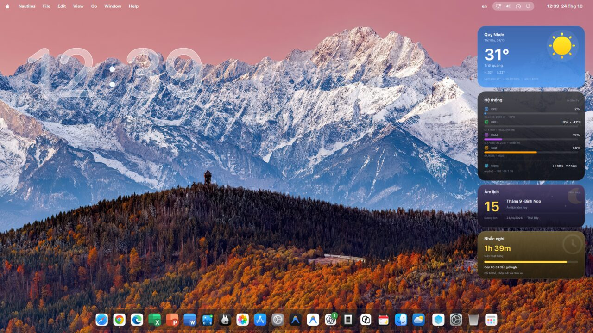
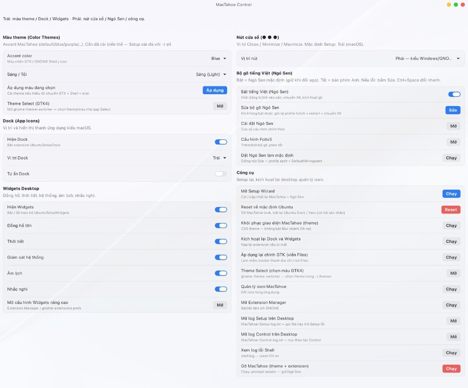
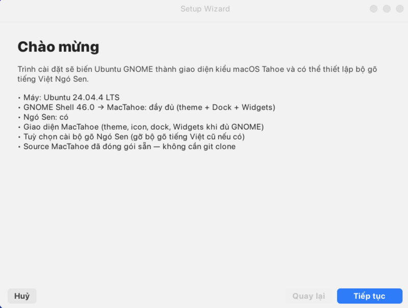
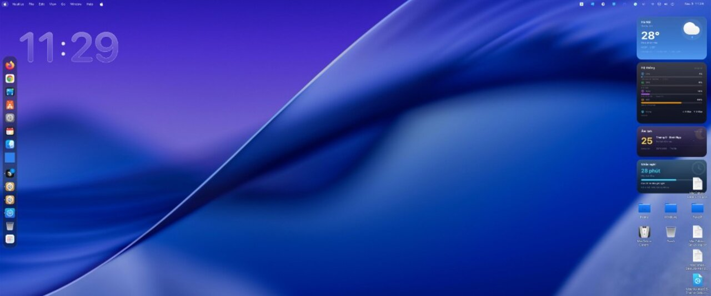

# Ubuntu macOS Theme — Make Ubuntu look like macOS

**MacTahoe Setup** turns Ubuntu GNOME into a **macOS-style desktop**: MacTahoe theme, Mac Dock, desktop Widgets, and optional Vietnamese input (**Ngó Sen**).

**Supported:** **Ubuntu 20.04 → current LTS / interim** (adaptive install). Best experience on **Ubuntu 24.04+**.

## Gallery (Ubuntu 24.04)

<p align="center">
  
</p>

| Control app | Setup Wizard |
|-------------|--------------|
|  |  |

<p align="center">
  
</p>

| Download / docs | |
|-----------------|--|
| **[AppImage Setup](https://github.com/manguonmocom/ubuntu-macos-theme/releases/latest/download/Ubuntu-macOS-Theme-Setup-x86_64.AppImage)** | Double-click GUI installer |
| **[GUIDE.md](./GUIDE.md)** | English guide |
| **[HUONG-DAN.md](./HUONG-DAN.md)** | Hướng dẫn tiếng Việt |

**Keywords:** Ubuntu macOS theme · make Ubuntu look like Mac · MacTahoe · GNOME Dock · Ubuntu 20.04 22.04 24.04 theme · macOS desktop Linux

## Support matrix

| Ubuntu | What you get |
|--------|----------------|
| **24.04 LTS and newer** | Full: theme, icons, Dock, Widgets, optional Ngó Sen & GDM |
| **22.04 LTS** | Theme + icons + Ngó Sen (no Dock/Widgets — needs GNOME ≥45) |
| **20.04 LTS** | Theme + icons (best-effort; CLI Setup if no GTK4/Adw) |

## Install

1. Download **`Ubuntu-macOS-Theme-Setup-x86_64.AppImage`** from [Releases](https://github.com/manguonmocom/ubuntu-macos-theme/releases/latest).
2. Mark executable (Properties → *Executable as program* / Allow Launching).
3. **Double-click** — Setup Wizard opens (no terminal required on 22.04+ with GTK4).
4. Keep **MacTahoe** checked; optionally enable **Ngó Sen**. Enter your password when asked.

```bash
chmod +x Ubuntu-macOS-Theme-Setup-x86_64.AppImage
./Ubuntu-macOS-Theme-Setup-x86_64.AppImage
```

Then open **MacTahoe Control** → **Preset Mac-like** (optional) for Dock left, traffic-light buttons, wallpaper, and panel clock in one click.

## Highlights after Setup

- **Wallpaper** Day/Night — Control → Apply wallpaper
- **Preset Mac-like** — Dock left · buttons left · panel · theme
- **Spotlight-like** — optional Ulauncher (`Super+Space`)
- **Fonts** — optional SF Pro / Inter pack from Control

## Requirements

- Ubuntu **20.04 or newer** (GNOME session)
- Prefer **Ubuntu on Xorg** when available
- Normal user with `sudo` — **do not** run the AppImage with `sudo`
- After first install on Wayland: **log out and back in** once so Dock/Widgets load

## Guides

- English: [GUIDE.md](./GUIDE.md)
- Tiếng Việt: [HUONG-DAN.md](./HUONG-DAN.md)
